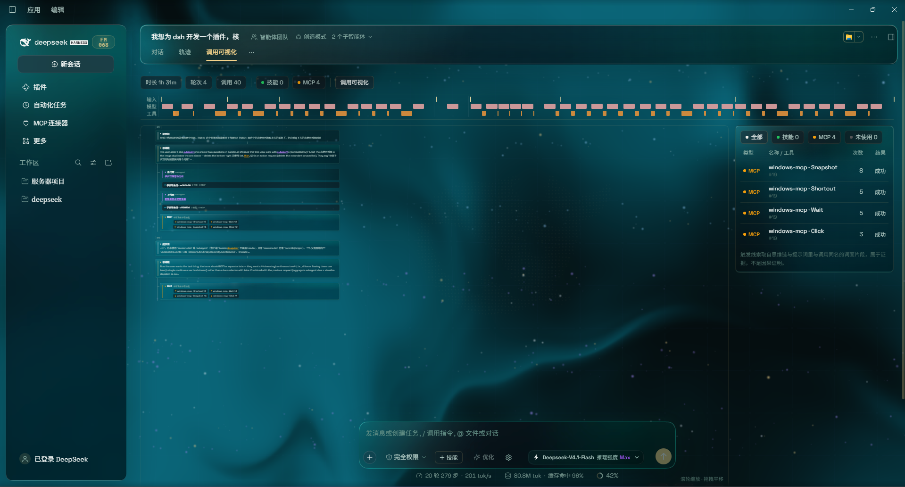
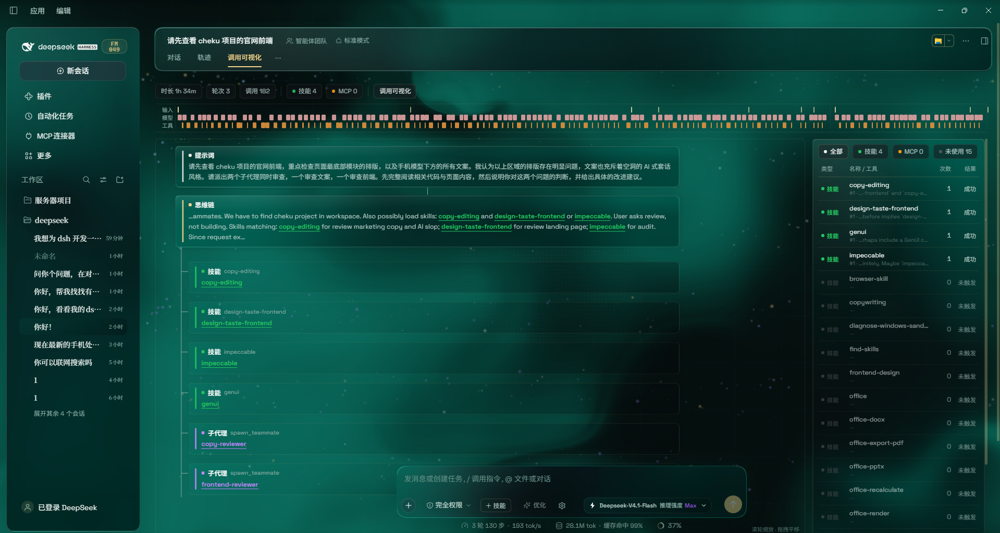

# call-map · 调用可视化

[中文](#zh) ｜ [English](#en)

<a id="zh"></a>

## 中文

一个 DeepSeek Harness（DSH）插件：在会话里多看一页，把「这一轮到底调用了哪些**技能**、哪些 **MCP**、派了哪些**子代理**，以及它们是被提示词和思维链里的哪句话带出来的」画成一张可缩放的分支图。

它不埋点、不上传：所有信息都来自本机会话日志。

---

### 它解决什么

DSH 自带两个会话视图：`对话`（消息流）和 `轨迹`（时间轴泳道：输入 / 模型 / 工具）。轨迹能回答「什么时候、花了多久」，但回答不了：

- 这条工具调用是**哪个技能**带出来的？
- 我配了 5 个 MCP，本会话**用了哪几个**、哪些一次没碰？
- 这次派给子代理的活，子代理内部又调了什么？
- 一句话里，是哪个词把它引到这一步的？

`调用可视化` 就是补这一层：**归因**，而不是时序。

---

### 树状图可缩放：一页看完整场对话



所有轮次按时间顺序**连续排在同一张画布上**，不再靠标签页切换：

- **滚轮缩放**（30%–240%），**按住左键拖拽平移**，右下角实时显示当前比例；
- 进入这个页签时**默认定位到最新一轮**，并按画布宽度自适应缩放，一眼看到「现在跑到哪了」；
- 右下角 `最新` 一键定位最后一轮对话，`全览` 把整棵树缩进一屏；

---

### 能看到详细的子代理 / 技能调用



树会一直展开到最细一层，左侧是链路，右侧是同源的调用明细：

- **技能**（绿）：这一轮加载了哪些技能，各命中几次；
- **派发**（紫）：`spawn_teammate` / `subagent` / `workflow` / `ralph` 本身也是节点，节点下面挂**子代理卡片**——插件会去读那个子代理会话自己的技能 / MCP 调用并折叠进来，点卡片直达该子会话；
- **MCP**（琥珀）：某个技能激活期间实际调用的 MCP 工具，带次数（如 `windows-mcp · Click ×6`）；
- **提示词 / 思维链**（蓝 / 紫蓝）：正文里与下层节点同名的词**按目标着色**，所以「哪个词引出了哪个节点」是肉眼可追的；
- **右侧明细表**：类型 / 名称·工具 / 次数 / 轮次 + 触发线索 / 结果，可筛 `全部` `技能` `MCP` `未使用`，点行打开宿主原生调用详情。

---

### 功能

| 能力 | 说明 |
| --- | --- |
| 一页聚合 | 所有轮次按时间顺序连续排布，不用来回切页 |
| 可缩放画布 | 滚轮缩放（30%–240%）、拖拽平移、`最新` / `全览` 一键归位；进入默认落在最新一轮 |
| 归因树 | `提示词 → 思维链 → 技能 / MCP / 子代理`，命中的词按目标节点上色（技能绿、MCP 琥珀、子代理紫） |
| 子代理聚合 | 派发节点独立成类；能拿到子会话时，把子会话内部的技能/MCP 折叠成筹码挂在下面，点卡片直达该子会话 |
| 调用明细表 | 类型 / 名称 / 次数 / 轮次 / 触发线索 / 结果，可筛「全部 / 技能 / MCP / 未使用」，点行打开宿主原生调用详情 |
| 未使用清单 | 本会话可用但一次没调用的技能与 MCP（`未使用` 筛选即可看到） |
| 轨道图 | 输入 / 模型 / 工具三泳道时间条，用于快速定位「哪一段在干什么」 |

---

### 安装

要求：DSH 已安装并可用（本插件注册的是既有槽位 `conversation.view`，不改宿主编译产物）。

**方式一：DSH 内置插件管理器（推荐）**

把本目录作为本地包安装：

```text
plugin_manager install_bundle  target = <本目录的绝对路径>
```

安装后**刷新页面**，会话头部会多出第三个视图标签 `调用可视化`。

也可以直接从 GitHub 安装：本仓库已声明 `dsh.bundle` manifest，可被 `dsh plugin add` 识别（纯 JS，无构建步骤）。插件已按 [awesome-dsh-plugin](https://github.com/awesome-dsh-plugin/awesome-dsh-plugin) 的收录规范备好元数据：`assets/icon-180.png` 为市场卡片图标，`screenshots.json` 声明商店详情页截图。

**方式二：手动挂载**

1. 把本目录放到任意位置；
2. 在 profile 目录执行 `pnpm add <本目录绝对路径>`（或把它软链进 `node_modules/call-map`）；
3. 在 profile 的 `package.json` 的 `dsh.profile.bundles` 数组里加入 `call-map`；
4. 重启 / 刷新。

**卸载**：`plugin_manager remove_bundle  target = call-map`。

---

### 使用

1. 打开任意会话，点头部 `调用可视化`；
2. 画布里滚轮缩放、按住左键拖拽平移（单击不会误触发拖动）；
3. 右下角 `最新` 回到最新一轮，`全览` 缩到整张图；
4. 右侧表格点行 → 打开该次调用的宿主原生详情；点子代理卡片 → 跳到对应子会话。

---

### 数据来源与口径

所有数据来自本地会话事件（`user/message`、`assistant/message`、`tool/call`、`tool/result`、`request/header`、`turn/start`），插件自身不写会话、不联网：

- **技能**：`skill` 工具的调用，技能名取自其 `arguments.name`；
- **MCP**：工具名形如 `mcp__<server>__<tool>` 的调用；
- **子代理**：`spawn_teammate` / `subagent` / `subagent_fork` / `workflow` / `ralph` 的派发调用；
- **未使用清单**：已注册技能目录（取自系统提示词中的 `<available_skills>`）与已向本会话暴露工具的 MCP server，减去实际调用的部分；
- **触发线索**：提示词 / 思维链里与调用同名的**词面片段**。

---

### 已知限制

- **触发线索是词面匹配，不是因果证明**。文字里没出现同名词就不标，不臆造归因；需要语义级解释应另加一次模型调用。
- **跨会话（子代理）聚合依赖能拿到子会话 id**：`subagent` / `workflow` 的结果里带 id，可直接聚合；`spawn_teammate` 只返回队友名，插件用「工作区会话标题 == 队友名」反查，队友会话被改名或尚未进入快照时会退化为「会话未加载」。
- **只读当前会话的事件窗口**：极长会话若早期事件未加载，早期轮次的提示词可能显示为「不在已加载的事件窗口里」。
- 本插件的**轨道图是自己重绘的**，与宿主 `轨迹` 页的原版图表不是同一实现；宿主的 `轨迹` 页本身不受影响。
- 宿主 `轨迹` 页的工具栏（时长 / 轮次 / 调用 那一行）没有对外插槽，所以本插件只能作为**并列的第三个页签**，无法把入口塞进那一行。

---

### 隐私

不采集、不发送任何数据。全部计算在本地前端完成，不新增网络请求。

---

### 目录结构

```text
call-map/
├─ package.json        # 包清单（dsh.bundle / dsh.client 声明）
├─ cordis.patch.yml    # bundle 补丁：插入一行插件
├─ index.js            # Host 半边（本插件为空实现）
├─ client.js           # 全部逻辑：折叠会话事件 + 视图渲染
├─ locale/en.json      # 插件管理页显示名（英文）
├─ locale/zh.json      # 插件管理页显示名（中文）
├─ docs/*.png          # README 截图
├─ assets/icon-180.png # 市场卡片图标（180×180 PNG）
├─ screenshots.json    # 市场详情页截图声明（1–8 张）
└─ icon.svg            # 插件图标
```

---

<a id="en"></a>

## English

A DeepSeek Harness (DSH) plugin that adds one more page to a session: it draws **which skills, which MCP tools, and which subagents** were actually used this turn — and **which sentence or word in the prompt / reasoning brought them in** — as a zoomable branch diagram.

No instrumentation, no uploads: every number comes from the local session log.

---

### What it solves

DSH ships two session views: `Chat` (the message stream) and `Trajectory` (a timing overview with input / model / tool lanes). Trajectory answers "when, and for how long". It cannot answer:

- Which **skill** produced this tool call?
- I configured five MCP servers — which ones did this session actually use, and which were never touched?
- What did the subagent I dispatched actually do inside?
- In that prompt, which word is responsible for this step?

`Call map` adds exactly that layer: **attribution**, not chronology.

---

### Zoomable tree: the whole conversation on one page


Every turn is laid out **continuously on a single canvas**, instead of one tab per turn:

- **Wheel to zoom** (30%–240%), **hold the left button to pan**; the live scale sits in the bottom-right corner;
- Opening the tab **starts at the latest turn** and fits the canvas to the available width, so you immediately see where the work is;
- `Latest` jumps back to the newest turn, `Overview` shrinks the whole tree into one screen;
- **A left click never starts a drag**: panning engages only after the pointer travels 4px, so clicking a card is just a click.

---

### Detailed subagent / skill calls


The tree expands all the way down; the chain is on the left, the matching call table on the right:

- **Skill** (green): which skills this turn loaded, and how often each was hit;
- **Dispatch** (purple): `spawn_teammate` / `subagent` / `workflow` / `ralph` are nodes too, with **subagent cards** underneath — the plugin reads that child session's own skills / MCP calls and folds them in; click a card to jump to the child session;
- **MCP** (amber): the MCP tools called while a skill was active, with counts (e.g. `windows-mcp · Click ×6`);
- **Prompt / reasoning** (blue / indigo): words in the text that match a lower node are **coloured by their target**, so "which word led to which node" is visible at a glance;
- **Right-hand table**: type / name·tool / count / turn + trigger trail / result, filterable by `All` `Skills` `MCP` `Unused`; click a row to open the host's native call inspector.

---

### Features

| Capability | Description |
| --- | --- |
| One-page aggregation | Every turn laid out chronologically on one canvas; no tab switching |
| Zoomable canvas | Wheel zoom (30%–240%), drag to pan, `Latest` / `Overview` shortcuts; opens on the latest turn |
| Attribution tree | `Prompt → reasoning → skill / MCP / dispatch`, with matched words coloured per target node |
| Subagent aggregation | Dispatch is its own node class; when a child session is reachable its skills / MCP are folded in as chips, and the card opens that session |
| Call table | Type / name / count / turn / trigger trail / result, filter by all / skills / MCP / unused; click a row for the host's native inspector |
| Unused inventory | Skills and MCP servers available in this session but never called (the `Unused` filter) |
| Lane chart | Input / model / tool time lanes for "what was happening when" |

---

### Install

Requires a working DSH install. The plugin registers into the existing `conversation.view` slot and does not modify any shipped build output.

**Option 1 — DSH plugin manager (recommended)**

Install this directory as a local package:

```text
plugin_manager install_bundle  target = <absolute path to this directory>
```

Then **reload the page**: a third view tab, `Call map`, appears next to `Chat` and `Trajectory`.

You can also install straight from GitHub: the repo declares the `dsh.bundle` manifest, so `dsh plugin add` can pick it up (plain JS, no build step). Marketplace metadata follows the [awesome-dsh-plugin](https://github.com/awesome-dsh-plugin/awesome-dsh-plugin) conventions: `assets/icon-180.png` is the storefront tile and `screenshots.json` declares the store screenshots.

**Option 2 — manual mount**

1. Put this directory anywhere;
2. In the profile directory run `pnpm add <absolute path>` (or symlink it into `node_modules/call-map`);
3. Add `call-map` to the `dsh.profile.bundles` array in the profile's `package.json`;
4. Restart / reload.

**Uninstall**: `plugin_manager remove_bundle  target = call-map`.

---

### Usage

1. Open any session and click `Call map` in the header;
2. Wheel to zoom, hold the left button to pan (a click never starts a drag);
3. `Latest` returns to the newest turn, `Overview` fits the whole tree;
4. Click a table row to open the host's native call inspector; click a subagent card to jump to that child session.

---

### Data sources and definitions

Everything comes from local session events (`user/message`, `assistant/message`, `tool/call`, `tool/result`, `request/header`, `turn/start`). The plugin never writes to a session and never touches the network:

- **Skill**: a `skill` tool call, named by its `arguments.name`;
- **MCP**: a tool call whose name matches `mcp__<server>__<tool>`;
- **Subagent**: a dispatch call to `spawn_teammate` / `subagent` / `subagent_fork` / `workflow` / `ralph`;
- **Unused inventory**: the registered skill catalogue (from the `<available_skills>` block in the system prompt) plus MCP servers that exposed tools to this session, minus what was actually called;
- **Trigger trail**: the **lexical fragment** in the prompt / reasoning that matches the call.

---

### Known limitations

- **The trigger trail is lexical matching, not proof of causality.** If no matching word appears in the text, nothing is highlighted — the plugin does not invent attribution. Semantic attribution would need an extra model call.
- **Cross-session (subagent) aggregation depends on getting a child session id**: `subagent` / `workflow` results carry one; `spawn_teammate` only returns a teammate name, so the plugin looks it up by "workspace session title == teammate name" and degrades to "session not loaded" when that fails.
- **Only the loaded event window is read**: in a very long session, early turns may show "the prompt of this turn is outside the loaded event window".
- **The lane chart is re-drawn by this plugin** and is not the shipped Trajectory implementation; the host's `Trajectory` page is untouched.
- The host Trajectory toolbar (the duration / turns / calls row) exposes no slot to plugins, so this plugin can only be a **parallel third tab** — the entry point cannot live inside that row.

---

### Privacy

No collection, no transmission. All computation happens in the local front-end, with no additional network requests.

---

### Layout

```text
call-map/
├─ package.json        # package manifest (dsh.bundle / dsh.client)
├─ cordis.patch.yml    # bundle patch: inserts one plugin row
├─ index.js            # Host half (empty for this plugin)
├─ client.js           # all logic: session-event folding + view rendering
├─ locale/en.json      # plugin-page display name (English)
├─ locale/zh.json      # plugin-page display name (Chinese)
├─ docs/*.png          # README screenshots
├─ assets/icon-180.png # storefront tile (180x180 PNG)
├─ screenshots.json    # store screenshots (1-8 images)
└─ icon.svg            # plugin icon
```

---

## License

MIT
